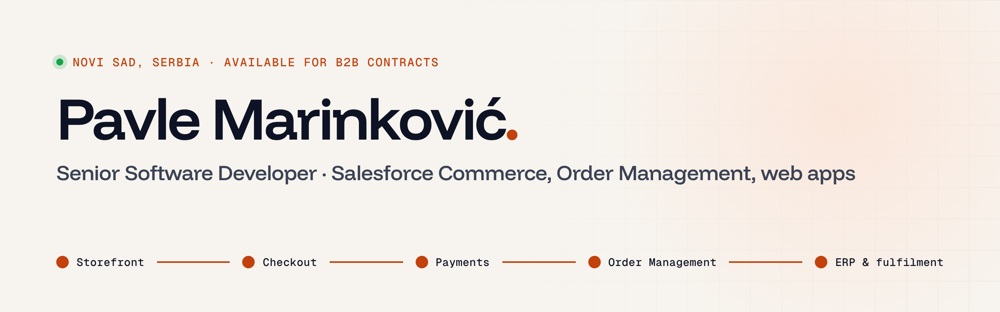

<a href="https://pavlemarinkovic.com">
  <picture>
    <source media="(prefers-color-scheme: dark)" srcset="assets/header-dark.png">
    
  </picture>
</a>

  
  
  
  

I build the parts of Salesforce Commerce that don't work out of the box: custom checkout and payment flows, product configurators, Order Management processes, and integrations with SAP, payment providers and in-store systems. I've done it since 2020 for retailers and manufacturers across Europe, and at BEE IT I lead a team of three developers.

Outside Salesforce I build websites and web apps in JavaScript, React, Next.js and Node.js.

### Selected work

| Project | What I worked on |
| --- | --- |
| [HEMA](https://pavlemarinkovic.com/work/hema/) | Backend lead for the B2C Commerce webshop and native apps: made-to-measure curtains, loyalty, Adyen payments |
| [Loro Piana](https://pavlemarinkovic.com/work/loro-piana/) | Checkout, Adyen, Business Manager extensions and price and availability jobs on B2C Commerce |
| [Belgian supermarket chain](https://pavlemarinkovic.com/work/belgian-supermarket-chain/) | Salesforce Order Management with in-store picking, MarketPay payments and headless APIs |
| [Oerlikon Metco](https://pavlemarinkovic.com/work/oerlikon-metco/) | Moving the myMetco store to Salesforce B2B Commerce, with orders, invoices and shipments from SAP |

### My own products

- **[Raceora](https://raceora.com)**: a platform for finding and entering endurance races. I design, build and run it.
- **[Amazfit watch apps](https://pavlemarinkovic.com/watch/)**: SaunaPal, RallyPal, RefPal and the TrailPulse watch face, on the Zepp store.

### Stack

 

 

### Contact

Open to B2B contracts: joining your team, or taking over a part of the project on my own.

- Email: [pavle019@live.com](mailto:pavle019@live.com)
- Intro call: [cal.com/pavlemarinkovic/intro](https://cal.com/pavlemarinkovic/intro)
- Writing: [dev.to/pavle019](https://dev.to/pavle019)
